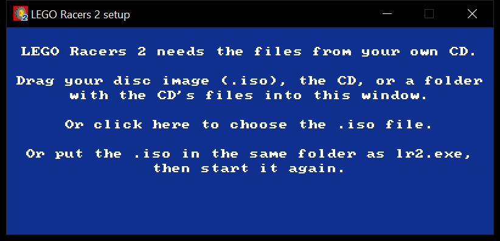
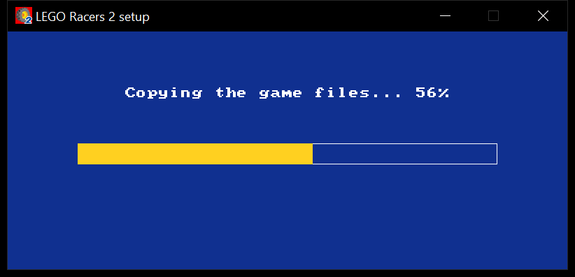

# LEGO Racers 2: native port

> [!WARNING]
> **This is an unofficial fan project.** It is not affiliated with,
> sponsored, endorsed or supported by the LEGO Group, Attention to Detail or
> any other rights holder of LEGO Racers 2. LEGO is a trademark of the LEGO
> Group. No game files are included: you need your own copy of the original
> CD to play.

A native build of LEGO Racers 2 for PC (2001). The original Windows `.exe`
is statically recompiled into C (`build/gen/`), and a small runtime
(`runtime/`) stands in for Windows, Direct3D 8, DirectInput and DirectSound
using SDL3 and OpenGL. The result is an ordinary native program: no Wine,
no emulator, and it runs on ARM64 Macs.

On top of the original game it adds:

- savestates (10 slots, also from a controller);
- gamepad support through SDL (Xbox, PlayStation, Switch Pro and other pads);
- an HD texture pack, used in place of the original textures.

| Platform | Status |
|---|---|
| Linux / WSL2 (x86-64) | Builds and runs; this is where the port is developed and tested. |
| Windows 10/11 x64 | Native build (cross-compiled); tested on Windows 10. |
| Windows 11 on ARM64 | Native build (cross-compiled); not tested on ARM hardware yet. |
| macOS (Apple Silicon) | Native arm64 build with the steps below; built on a MacBook. |
| macOS (Intel) | Should build with the same steps; not tried. |

## Download

Ready-to-play packages are on the
**[Releases page](https://github.com/Spaggel/lr2/releases)**:

| Your computer | Download |
|---|---|
| Windows 10/11 (most PCs) | `LR2-windows-x64.zip` |
| Windows 11 on ARM | `LR2-windows-arm64.zip` |
| macOS 11 or newer (Apple Silicon and Intel) | `LR2-macos.zip` |
| Linux (x86-64) | `LR2-linux-x86_64.tar.gz` |

Unpack it into a folder of its own (for example in Documents) and start
`lr2.exe` (Windows), the LEGO Racers 2 app (macOS) or `lr2` (Linux). The
`README.txt` in the package explains everything, including what to do
when Windows or macOS warns about an unknown developer. Nothing else needs
to be installed.

> **macOS: run this once before the first start**, or the game will not
> work (the app is not signed by Apple, so macOS blocks it and keeps it in
> quarantine). In Terminal, in the folder you unpacked:
>
> ```sh
> xattr -cr LEGO\ Racers\ 2.app
> ```
>
> (Or type `xattr -cr ` and drag the app into the Terminal window.)

## First start: copying the game from your CD

The packages contain no game files. The first time the game starts, a
setup window asks for your LEGO Racers 2 CD:



Drag your disc image (.iso), the CD itself or a folder with a copy of its
files into the window, or click it to choose the .iso. An .iso that is
already in the same folder as the game is used without asking. The game
then copies the files it needs into a `game` folder next to itself (about
500 MB, well under a minute):



When the copy is done the game starts by itself; from then on the CD or
.iso is no longer needed.

## Building it yourself: what you need

To play, use the packages from the
[Releases page](https://github.com/Spaggel/lr2/releases); the rest of this
section and the build instructions below are for building from source.

- The source with git, so the SDL3 and zlib submodules can be fetched (the
  "Source code" downloads on the Releases page do not include them):

  ```sh
  git clone https://github.com/Spaggel/lr2.git legoracers
  ```

- Your own LEGO Racers 2 CD or disc image (.iso). The game's assets are not
  in this repository and not in the release packages. On first start the
  game opens a setup window: drag the .iso, the CD or a folder with its
  files into it, and it copies them into `game/` next to the program
  (`lr2 --setup "LEGO Racers 2.iso"` does the same without the window).
  For development, `game/cd` in the repository root works too
  (`python3 tools/extract_iso.py "LEGO Racers 2.iso" game/cd`).
- The original executable is not in this repository and is not needed to
  build: the recompiled C code, including the image's data sections
  (`build/gen/gen_image.c`), is checked in. Only regenerating that code
  needs the exe from your CD (see "Regenerating the C code").
- The HD texture pack in `HD TEXTURES/` (already in this repo), by dorpz;
  see `CREDITS.md`.
- A C compiler, CMake 3.20 or newer, Ninja, and SDL3.

The recompiled C sources are checked in under `build/gen`, so Python is only
needed if you change the recompiler (see "Regenerating the C code").

## macOS

1. Install the tools. With [Homebrew](https://brew.sh):

   ```sh
   xcode-select --install          # Apple's compiler, if not installed yet
   brew install cmake ninja sdl3
   ```

2. Clone this repository (see "Building it yourself") and fetch the
   bundled zlib:

   ```sh
   cd legoracers
   git submodule update --init third_party/zlib
   ```

3. Build:

   ```sh
   cmake -S . -B build/native -G Ninja -DCMAKE_PREFIX_PATH="$(brew --prefix)"
   ninja -C build/native
   ```

   Or just `make` (same steps, including the submodule; `make run` builds
   and starts the game, `make clean` removes the build).

   This produces `build/native/lr2`, a native arm64 binary on Apple Silicon.

   To update later: `git pull`, then `ninja -C build/native` again.

4. Run it from the repository root:

   ```sh
   build/native/lr2
   ```

   It finds the game in `game/cd` by itself if you extracted your CD there
   (the same as `--game game/cd/install --cd game/cd --save game/save`);
   otherwise the setup window asks for your CD. Saves and settings go to
   `game/save`. The HD textures are picked up
   automatically because `HD TEXTURES/` is in the current directory; see
   "HD textures" below.

If you would rather not use Homebrew's SDL3, build the copy in
`third_party/SDL3` (`git submodule update --init third_party/SDL3`) and
point `CMAKE_PREFIX_PATH` at its install prefix, as in the Linux steps.

On a MacBook keyboard the savestate keys (F5, F9, ...) need the Fn key
unless "Use F1, F2, etc. keys as standard function keys" is enabled in
System Settings > Keyboard.

## Windows 10 / 11

The Windows version is a single `lr2.exe` with no installer and no DLLs to
ship. It runs on x64 PCs and on Windows on ARM (ARM64).

### Building it

The exe is cross-compiled on Linux (including WSL2) or macOS with
[llvm-mingw](https://github.com/mstorsjo/llvm-mingw). It needs CMake,
Ninja, curl and Python 3; the script downloads llvm-mingw into
`tools/local` and builds SDL3 from `third_party/SDL3` as a static library.

```sh
git submodule update --init third_party/SDL3 third_party/zlib
tools/build-windows.sh --zip                # both x64 and ARM64
tools/build-windows.sh --zip x86_64         # or just one
```

The result:

- `build/windows-x86_64/lr2.exe` and `build/windows-aarch64/lr2.exe`;
- portable folders `dist/LR2-windows-x64/` and `dist/LR2-windows-arm64/`,
  each with `lr2.exe`, the `HD TEXTURES` pack and a `README.txt` for
  players (`tools/player-readme.txt`), but no game files;
- with `--zip` (or `--package`): a `.zip` of each folder as well.

### Running it

1. Copy `dist/LR2-windows-x64` (or the arm64 one) to the Windows PC, or
   download the package from the
   [Releases page](https://github.com/Spaggel/lr2/releases).
2. Double-click `lr2.exe`. The first time, drag your LEGO Racers 2 .iso
   (or the CD) into the setup window; the files go to `game\`. Windows SmartScreen may warn about an unknown
   publisher because the exe is not signed: choose "More info" and then
   "Run anyway".

Saves, settings and savestates go to `game\save`; `game\save\lr2.log` is
the log when the game was started by double-clicking. For a window
instead of full screen, start it with `--windowed` (for example from a
shortcut). On Windows on ARM, OpenGL 3.3 comes from Microsoft's "OpenCL,
OpenGL, and Vulkan Compatibility Pack" in the Microsoft Store; install it
if the game does not start.

### Alternative: the Linux build under WSL2

The Linux build also runs on Windows through WSL2, whose WSLg shows Linux
windows on the Windows desktop with sound and GPU acceleration. Game
controllers are generally not passed through to WSL, so the native build
is the better choice for playing.

1. In PowerShell, install WSL and Ubuntu, then restart if asked:

   ```powershell
   wsl --install -d Ubuntu
   ```

2. In the Ubuntu terminal, install the build tools and SDL3's dependencies:

   ```sh
   sudo apt update
   sudo apt install build-essential cmake ninja-build git \
       libx11-dev libxext-dev libxrandr-dev libxcursor-dev libxi-dev \
       libxss-dev libxkbcommon-dev libgl-dev libegl-dev \
       libpulse-dev libasound2-dev libudev-dev
   ```

3. Put the repository inside the Linux file system (for example
   `~/legoracers`, not under `/mnt/c`, which is much slower), then build
   SDL3 and the game:

   ```sh
   cd ~/legoracers
   git submodule update --init third_party/SDL3 third_party/zlib
   cmake -S third_party/SDL3 -B third_party/build/SDL3 -G Ninja \
       -DCMAKE_BUILD_TYPE=Release -DCMAKE_INSTALL_PREFIX="$PWD/tools/local" \
       -DSDL_TESTS=OFF -DSDL_EXAMPLES=OFF
   ninja -C third_party/build/SDL3 install
   cmake -S . -B build/native -G Ninja -DCMAKE_PREFIX_PATH="$PWD/tools/local"
   ninja -C build/native
   ```

4. Run `build/native/lr2` from the repository root.

The same steps work on a regular Linux machine.

## Playing

The game starts full screen at the display's native resolution, with the
3D view widened for widescreen (menus and the HUD stretch to fit). Other
resolutions are under Game Options; the choice is saved. Use `--windowed`
(or set `LR2_WINDOWED=1`) to run it in a window.

**Keyboard:** the arrow keys steer, accelerate (Up) and brake (Down); Enter
confirms and Esc goes back. The other controls are listed, and can be
changed, under Game Options in the game.

**Controller:** connect the pad before starting the game (the game only
looks for controllers when it starts). Any pad SDL knows works (Xbox,
PlayStation, Switch Pro, ...); buttons are named by their Xbox position
below. The first pad drives player 1, a second pad player 2, and the
keyboard keeps working alongside.

| Race | Controller | Menus | Controller |
|---|---|---|---|
| Steer | left stick, d-pad | Move | left stick, d-pad |
| Accelerate | RT | Confirm | A |
| Brake / reverse | LT | Back | B |
| Hard brake | B | Pause / resume | Start |
| Fire weapon | A | | |
| Brick boost | X | | |
| Talk (adventure) | Y | | |
| Look behind | LB or right-stick click | | |
| Next / previous target | RB or d-pad down / d-pad up | | |
| Pause | Start | | |

This layout is used while the player's controls are set to Keyboard in the
game's options (the default). Choosing Joystick there switches to the
game's own button setup, which the options screen lets you change.

**Savestates:** a savestate captures the whole game at that moment, including
mid-race, and loading it puts you back exactly there.

| Action | Keyboard | Controller |
|---|---|---|
| Save to the current slot | F5 | hold Back/View/Select, press LB |
| Load the current slot | F9 | hold Back/View/Select, press RB |
| Previous / next slot | F6 / F7 | |

There are 10 slots, 0-9; the current slot is 0 when the game starts. States are written to
`<save dir>/states/slotN.lr2s` (about 30 MB each) and survive restarts. They
belong to this build of the port: after updating the recompiled code, old
states may refuse to load. A state saved with HD textures only loads with
the same texture pack enabled, and one saved without them only with
`--no-hd`.

## HD textures

The `HD TEXTURES` folder holds replacement `.MIP` textures laid out like the
game's own data (`HD TEXTURES/game data/<world>/...`). The original game
reads everything from its archive `GameData.gtc` and never looks at loose
files, so the runtime serves the replacement files from inside the archive:
it presents the game with an index (`FileList.Inf`/`Compress.Inf`) in which
each replaced texture points at an extra, uncompressed part of the archive
that is read from the pack. The original files on disk are not changed.

- The pack is used automatically when a folder named `HD TEXTURES` is in
  the game directory (`--game`), the CD directory (`--cd`) or the current
  directory. The log shows `hd: 2180 replacement files from ...`.
- `--hd DIR` uses a pack somewhere else.
- `--no-hd` plays with the original textures.

Only files whose names match a file in the game's archive are used; the
log reports how many others there are, and they are ignored. The game renders at its own
resolution, so the improvement shows most on close-up objects such as
characters and cars.

## Command-line options

```
lr2 [options]
  --game DIR   directory with the game's .exe (default: see below)
  --cd DIR     directory with the CD contents (default: game dir)
  --save DIR   directory for saves/settings (default: <game>/save)
  --hd DIR     HD texture pack (default: an "HD TEXTURES" folder in the
               game dir, CD dir, current dir or next to lr2, if there is one)
  --no-hd      use the original textures
  --windowed   run in a window instead of full screen
  --log N      log level 0-4 (default 2)
```

Without `--game`, lr2 looks in the current directory and in its own
directory for the game's exe, either directly or in `game/install` (the
Windows package layout, where `game` holds the CD) or `game/cd/install`
(this repository). It then uses the folder above `install` as the CD and
`game/save` for saves.

Arguments starting with `/` (such as `/nomusic`) are passed on to the game.

## Release packages

Players get a ready-to-run package per OS with the HD textures built in
and no game files:

| Package | Built by | Contents |
|---|---|---|
| `LR2-macos.zip` | `tools/package.sh` on a Mac | `LEGO Racers 2.app` (arm64 + x86_64, HD pack in `Contents/Resources`) |
| `LR2-linux-<arch>.tar.gz` | `tools/package.sh` on Linux | `lr2`, `HD TEXTURES/` |
| `LR2-windows-<x64\|arm64>.zip` | `tools/build-windows.sh --zip` | `lr2.exe`, `HD TEXTURES/` |

Each also holds `README.txt` (`tools/player-readme.txt`). SDL3 is linked
statically, so nothing needs to be installed. The game data goes to
`game/` next to the program (next to the `.app` on macOS).

`.github/workflows/release.yml` builds all of them on GitHub, but only
when a version tag is pushed: `git tag v1.0 && git push origin v1.0`
creates a release for `v1.0` with the packages attached. Pushes to
`master` do not build anything. The builds are
not code-signed, so Windows SmartScreen and macOS Gatekeeper warn on first
start (the player README says how to get past that).

## Regenerating the C code

`build/gen` is produced by the static recompiler from the original exe.
You only need to run it after changing the recompiler in `tools/recomp`.
The exe is not in this repository: copy `install/LEGO Racers 2.exe` from
your own CD to `orig/LEGORacers2.exe` (ignored by git), for example with
`python3 tools/extract_iso.py "LEGO Racers 2.iso" game/cd`. Then:

```sh
python3 -m venv tools/.venv
tools/.venv/bin/pip install capstone pefile
tools/.venv/bin/python tools/recomp/recomp.py orig/LEGORacers2.exe build/gen \
    --ghidra build/ghidra_functions.txt
ninja -C build/native
```

## More

`SPEC.md` describes the design (the recompiler, the runtime, how savestates
work) and the remaining work in detail.

## License

This project's own code (the runtime in `runtime/`, the recompiler and
tools in `tools/`, the build files) is under the MIT license; see
`LICENSE`. It does not cover what comes from elsewhere: the game-derived
files (`build/gen`, the analysis files in `build/`, the icons), the HD
texture pack, or the libraries in `third_party/`, which keep their own
terms (see `CREDITS.md`).

## Credits

LEGO Racers 2 is by Attention to Detail and LEGO Software; LEGO is a
trademark of the LEGO Group, which is not involved in this project. The HD
textures are by dorpz. `CREDITS.md` lists everything this project uses and
who made it; the player packages carry it with the full license texts in
`LICENSES/`.
